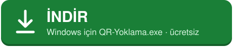

<div align="center">

# QR Yoklama

**Yoklama QR kodunu PowerPoint slaytının üstünde canlı gösterir.**

<br>

<a href="https://github.com/HilmiTuncay/qr-popup/releases/latest/download/QR-Yoklama.exe"></a>

<br><br>

[](https://github.com/HilmiTuncay/qr-popup/releases/latest)
[](LICENSE)
[](KVKK.md)

**[⬇️ Doğrudan indirme bağlantısı](https://github.com/HilmiTuncay/qr-popup/releases/latest/download/QR-Yoklama.exe)** — her zaman en yeni sürüm

</div>

---

### 3 adımda başlayın

1. **İndirin:** yukarıdaki yeşil düğmeye basın, `QR-Yoklama.exe` iner. Kurulum gerekmez.
2. **Açın:** dosyaya çift tıklayın. Windows *"Bilgisayarınız korundu"* derse **Ek bilgi → Yine de çalıştır**'a basın.
3. **Giriş yapın:** açılan Ayarlar'a kullanıcı adı ve şifrenizi yazıp **Kaydet**'e basın, sitede yoklamayı başlatın. QR, slaytın köşesinde belirir.

---

_Hilmi Tunçay_

Yoklama sitesini arka planda açık tutar, sayfadaki QR kodu **ekran görüntüsünden kendisi bulup okur** ve slaytın üstünde duran küçük bir pencerede **yeniden, net olarak** çizer. QR her yenilendiğinde (yeni anahtar) pencere de anında güncellenir. Sitenin QR'ı nasıl ürettiği (resim, canvas, SVG, tüm sayfa yenileme) önemli değildir, CSS seçicisi ayarlamak gerekmez.

## Kullanım (Windows)

1. İndirdiğiniz `QR-Yoklama.exe` dosyasını çalıştırın. Kurulum ve yönetici yetkisi gerekmez. İmzasız olduğu için Windows "bilinmeyen yayımcı" uyarısı verebilir: **Ek bilgi → Yine de çalıştır**.
2. İlk açılışta Ayarlar penceresi gelir. Adres hazır gelir (https://yoklama.uludag.edu.tr). Kullanıcı adı ve şifrenizi yazıp **Kaydet**'e basın.
3. Açılan pencerede kutular dolu gelir; **Giriş**'e basın ve QR'ın göründüğü yoklama ekranını başlatın. Ardından o pencereyi **kapatın** (uygulama kapanmaz, site arka planda açık kalır).
4. QR penceresi kendiliğinden köşede belirir. PowerPoint'i tam ekran başlatın.

Uygulama sistem tepsisinde (saatin yanındaki QR simgesi) çalışır. Giriş bilgileri/çerezler saklanır. Sonraki açılışlarda yoklama sayfası kendiliğinden açılır; genelde sadece yoklamayı başlatıp pencereyi kapatmak yeterlidir.

## Kısayollar (PowerPoint açıkken de çalışır)

| Kısayol | İşlev |
|---|---|
| Ctrl+Alt+Q | QR penceresini göster / gizle |
| Ctrl+Alt+B | QR'ı ekranın ortasında büyük göster (yoklama dakikaları için) / köşeye geri al |
| Ctrl+Alt+↑ / ↓ | Köşe penceresini büyüt / küçült |

Pencere fareyle sürüklenebilir; yeri hatırlanır. Ekran kenarına tam oturtulunca ya da biraz taşırılınca kenara/köşeye yapışır. Fareyle pencerenin üstüne gelince köşelerde tutamaçlar belirir; köşeden çekerek QR'ı büyütüp küçültebilirsiniz (kare kalır, karşı köşe yerinde durur). Tepsi menüsünden köşe, ekran (projektör) ve görünüm modu seçilebilir.

QR penceresinin alt çubuğunun sağında iki küçük düğme vardır: **⛶** QR'ı ekranın ortasında büyük gösterir (tekrar basınca köşeye döner), **–** pencereyi simge durumuna küçültür. Küçültülen pencere görev çubuğunda **QR Yoklama** simgesi olarak durur; simgeye tıklayınca geri gelir.

## Bilmeniz gerekenler

- **Kayıtlı şifre:** Şifre bu bilgisayarda Windows hesabınıza bağlı olarak şifrelenmiş saklanır ve yalnızca ayarlardaki yoklama sitesinin giriş sayfasına doldurulur. Uygulama kendisi giriş yapmaz; oturum düşerse tepsiden "Yoklama sayfasını göster" deyip **Giriş**'e basmanız yeterlidir. Ayarlar'dan "Kayıtlı şifreyi sil" ile kaldırılabilir.
- **Slayt durmaz:** QR penceresi odak almaz; üstüne tıklamak PowerPoint gösterisini duraklatmaz.
- **Durum çubuğu:** Yeşil = canlı (sitedeki geri sayım varsa "Canlı · 42 sn" gibi yeni QR'a kalan süre de yazar), turuncu = QR yenileniyor, kırmızı = QR bir süredir görünmüyor (oturum düşmüş olabilir → tepsiden "Yoklama sayfasını göster").
- **Otomatik gizleme:** QR sayfadan 20 sn kaybolursa pencere gizlenir, yeni yoklamada kendiliğinden geri gelir (Ayarlar'dan kapatılabilir).
- **İki ekran:** İkinci ekran (projektör) varsa pencere varsayılan olarak oraya konur. Tepsi → Ekran'dan değiştirilebilir.
- **Görünüm modları:** "Yeniden çiz" QR'ın içeriğini birebir aynı veriyle yeni ve keskin bir QR olarak çizer (projektörde en iyi okunan). Sorun yaşarsanız "Sayfadaki görüntüyü kırp" modu sitedeki QR'ı olduğu gibi gösterir.
- QR, sitenin penceresinde görünür alanda olmalı (sayfayı aşağı kaydırmanız gerekiyorsa pencereyi büyütün veya tarayıcıdaki gibi Ctrl+− ile küçültün).
- **KVKK ve gizlilik:** Uygulama hiçbir veriyi geliştiriciye ya da üçüncü kişilere göndermez; şifre bilgisayarda şifrelenmiş saklanır. Ayrıntılar: [KVKK ve Gizlilik Bilgilendirmesi](KVKK.md).
- Bu araç yalnızca sınıftaki ekranda göstermek içindir; kodu başka bir yere göndermez. Kullanmadan önce kurumunuzun yoklama kurallarına uygun olduğundan emin olun.

## Kaynaktan çalıştırma / derleme (Windows, macOS, Linux)

```bash
npm install
npm start                                   # geliştirme modunda çalıştır
npx electron-builder --win portable         # Windows tek dosya .exe
npx electron-builder --mac dmg              # macOS (Mac üzerinde)
```

Test: `node test/test-site.js` 4 saniyede bir değişen sahte bir yoklama sayfasını `http://127.0.0.1:8765` adresinde açar.

## Lisans

MIT — ayrıntılar için [LICENSE](LICENSE) dosyasına bakın.
